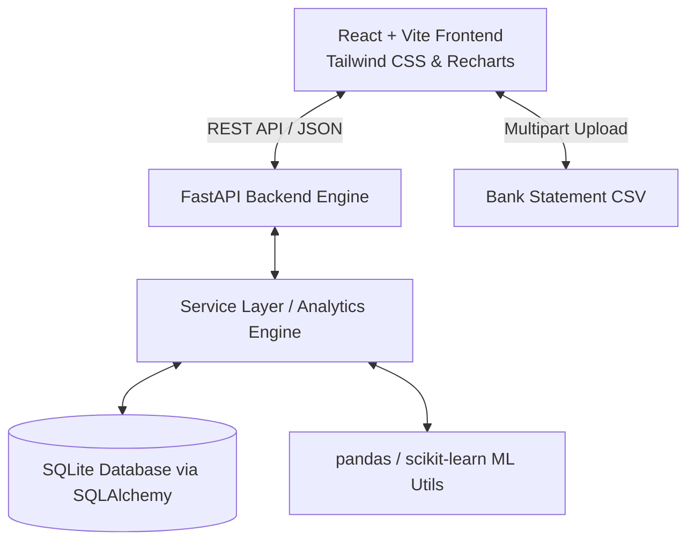

# Personal Finance Analyzer 💰🇮🇳

A full-stack, AI-powered financial management web application built for personal expense tracking and computer science project demonstrations. It processes bank statement CSVs, auto-categorizes transactions (tuned for Indian merchants and UPI/NEFT/IMPS descriptors), detects recurring payments and spending anomalies, provides category budgets and forecasts, and displays interactive dashboards formatted in INR (₹) with light/dark theme support.

---

## 🏗️ Architecture Overview



### Decoupled Client-Server Architecture
- **Backend**: Built with **FastAPI** (Python 3.11+) providing high-performance REST APIs with Pydantic v2 schemas for automatic request/response validation.
- **ORM & Storage**: **SQLAlchemy 2.0** with **SQLite** for zero-configuration, local-first data privacy (no cloud leakage).
- **ML & Analytics**: **scikit-learn** and **pandas** powering Z-Score outlier detection, Isolation Forest, interval variance recurring detectors, and Linear Regression forecasting.
- **Frontend**: **React 18** with **Vite**, **Tailwind CSS**, **Recharts** interactive charting, **Lucide React** icons, and **React Router v6**.

---

## ✨ Key Features

1. **Indian Banking & UPI Statement Ingestion**:
   - Auto-detects columns (`Date`, `Description`, `Amount`, `Debit`, `Credit`, `Type`).
   - Supports Indian number formatting (`1,23,456.50`, `₹`, `Rs.`, accounting parentheses `(500)`).
   - Handles multi-format dates (`DD/MM/YYYY`, `YYYY-MM-DD`, `DD-MMM-YYYY`).
   - Deduplication hashing via `sha256(date_desc_amount_type)` prevents duplicate imports.

2. **Smart Rule-Based Categorization & Feedback Learning**:
   - 100+ pre-seeded Indian merchant keywords (Swiggy, Zomato, Uber, Ola, IRCTC, D-Mart, Amazon, Bescom, Airtel, Netflix, etc.).
   - **Feedback Learning Loop**: When a user changes a category in the UI, the engine automatically extracts merchant keywords, updates/creates high-priority rules, and retroactively updates matching transactions.

3. **Anomaly & Outlier Detection**:
   - Combines statistical **Z-Score** ($Z > 2.5\sigma$) with **Isolation Forest** multivariate outlier detection.
   - Generates human-readable explanations (e.g. *"Amount ₹18,500 is 3.8x higher than your average Shopping expense of ₹4,800"*).

4. **Recurring Subscriptions Engine**:
   - Groups transactions by merchant and computes payment interval variances.
   - Accurately classifies monthly (~30d) and weekly (~7d) recurring cycles (Netflix, Rent, WiFi, Gym) and projects next due dates.

5. **AI Spending Forecasts**:
   - Blends **Weighted Moving Average** (50% recent, 30% previous, 20% older) with **Linear Regression** trends.
   - Computes per-category and total projected next-month expenditures with $R^2$ confidence scores.

6. **Interactive INR Dashboards & Budgets**:
   - Real-time Income vs Expense bar charts, category breakdown donut charts, and top merchants.
   - Category budget limits with traffic-light indicators (Green < 80%, Yellow 80-100%, Red > 100%).
   - One-click **"Load Demo Data"** to populate 6 months of realistic transactions instantly.

---

## 📁 Project Directory Structure

```
d:/New folder/
├── backend/
│   ├── app/
│   │   ├── main.py                 # FastAPI application entry point & CORS
│   │   ├── database.py             # SQLAlchemy session & SQLite engine
│   │   ├── config.py               # Pydantic Settings
│   │   ├── models/                 # SQLAlchemy ORM models (Transaction, Category, Rule, Budget)
│   │   ├── schemas/                # Pydantic v2 schemas
│   │   ├── routers/                # REST endpoints (upload, transactions, analytics, insights, budgets, demo)
│   │   ├── services/               # Core business logic & algorithms (csv_parser, categorizer, recurring, anomaly, forecast)
│   │   └── utils/                  # Currency formatting & 6-month seed data generator
│   ├── tests/                      # Pytest unit test suite (45 tests)
│   └── requirements.txt
├── frontend/
│   ├── src/
│   │   ├── components/             # Reusable UI components (dashboard, transactions, insights, budgets, common)
│   │   ├── pages/                  # Route pages (Dashboard, Transactions, Insights, Budgets, Rules)
│   │   ├── services/api.js         # Axios API client
│   │   ├── context/ThemeContext.js # Dark/Light theme provider
│   │   └── utils/formatters.js     # Indian Rupee (₹) & Date formatters
│   ├── package.json
│   ├── vite.config.js
│   └── tailwind.config.js
├── sample_statement.csv             # Realistic Indian bank statement for testing upload
├── README.md                        # Documentation
├── VIVA_NOTES.md                    # Examiner QA guide for algorithms & system design
└── implementation_plan.md           # Completed technical specifications
```

---

## 🚀 Quickstart Guide

### 1. Backend Setup

```bash
cd backend

# Create virtual environment (optional)
python -m venv venv
# Windows: venv\Scripts\activate

# Install dependencies
pip install -r requirements.txt

# Run pytest unit test suite (45 tests)
python -m pytest tests

# Start FastAPI development server
python -m uvicorn app.main:app --reload --port 8000
```
- API Documentation (Swagger UI): `http://127.0.0.1:8000/docs`

### 2. Frontend Setup

```bash
cd frontend

# Install node dependencies
npm install

# Start Vite React development server
npm run dev
```
- Web Application UI: `http://localhost:5173`

---

## 🧪 Testing

Run backend tests using:
```bash
cd backend
python -m pytest tests -v
```
All 45 tests validate:
- Indian currency parsing (`1,23,456.50`, `₹`, `Rs.`, `(500)`)
- Auto-column detection (single amount, split debit/credit, header keywords)
- Categorization rule priority and batch processing
- Recurring subscription interval variance detection
- Anomaly detection Z-Score thresholds
- Weighted Moving Average and Linear Regression forecasting

---

## 🇮🇳 Indian Financial Context Optimizations

- **Indian Number Grouping**: Formatted using `Intl.NumberFormat('en-IN')` (e.g., `₹1,23,456.00` instead of Western `₹123,456.00`).
- **UPI Descriptor Cleaning**: Transforms verbose UPI tags like `UPI-SWIGGY-BUNDL TECHNOLOGIES-123456@okaxis` into clean merchant names (`Swiggy`).
- **Indian Merchant Dictionary**: Built-in awareness of merchants like Zomato, Swiggy, Uber, Ola, Bescom, Tata Power, IRCTC, D-Mart, Blinkit, and Apollo Pharmacy.
