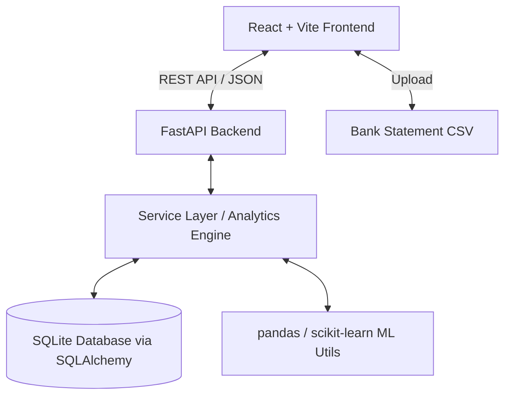

# Implementation Plan - Personal Finance Analyzer

The **Personal Finance Analyzer** is a full-stack financial management web application built for a computer science exam project. It processes bank statement CSVs, auto-categorizes transactions (tuned for Indian merchants), detects recurring payments and spending anomalies, provides category budgets and forecasts, and displays interactive dashboards—formatted in INR (₹) with light/dark theme support.

---

## 1. System Architecture & Tech Stack

### Tech Stack
- **Backend**: Python 3.11+, FastAPI, SQLAlchemy (ORM), SQLite database, pandas, scikit-learn, Pydantic v2, pytest
- **Frontend**: React (Vite, JS/JSX), Tailwind CSS, Recharts, React Router v6, Axios, Lucide React icons
- **Architecture**: Decoupled Client-Server REST API, single-user mode (no auth overhead required)

### High-Level Architecture Diagram


---

## 2. Directory Structure

```
d:/New folder/
├── backend/
│   ├── app/
│   │   ├── __init__.py
│   │   ├── main.py                 # FastAPI app entry point & CORS
│   │   ├── database.py             # SQLAlchemy session setup
│   │   ├── config.py               # Settings & env loading
│   │   ├── models/                 # SQLAlchemy DB Models
│   │   │   ├── __init__.py
│   │   │   ├── transaction.py
│   │   │   ├── category.py
│   │   │   ├── rule.py
│   │   │   └── budget.py
│   │   ├── schemas/                # Pydantic schemas for request/response validation
│   │   │   ├── transaction.py
│   │   │   ├── budget.py
│   │   │   ├── category.py
│   │   │   ├── rule.py
│   │   │   └── analytics.py
│   │   ├── routers/                # API Endpoints
│   │   │   ├── transactions.py
│   │   │   ├── upload.py
│   │   │   ├── categories.py
│   │   │   ├── budgets.py
│   │   │   ├── insights.py
│   │   │   └── demo.py
│   │   ├── services/               # Core Business Logic
│   │   │   ├── csv_parser.py       # CSV auto-column detection & Indian currency parsing
│   │   │   ├── categorizer.py      # Rule engine & feedback learning
│   │   │   ├── recurring.py        # Frequency & expected date algorithm
│   │   │   ├── anomaly.py          # Z-Score & Isolation Forest detector
│   │   │   └── forecast.py         # Linear regression & moving average forecasting
│   │   └── utils/
│   │       ├── currency.py
│   │       └── seed_data.py        # 6-month realistic demo transaction generator
│   ├── tests/                      # pytest unit test suite
│   │   ├── test_csv_parser.py
│   │   ├── test_categorizer.py
│   │   ├── test_recurring.py
│   │   ├── test_anomaly.py
│   │   └── test_forecast.py
│   ├── requirements.txt
│   ├── .env.example
│   └── .env
├── frontend/
│   ├── public/
│   ├── src/
│   │   ├── assets/
│   │   ├── components/
│   │   │   ├── common/             # Navbar, Sidebar, ThemeToggle, Card, Modal, LoadingSkeleton
│   │   │   ├── dashboard/          # SummaryCard, ExpenseChart, DonutChart, TopMerchants
│   │   │   ├── transactions/       # TransactionTable, UploadModal, ManualTransactionModal, ColumnMappingModal
│   │   │   ├── insights/           # InsightCard, AnomalyList, RecurringList, ForecastCard
│   │   │   └── budgets/            # BudgetProgressBar, EditBudgetModal
│   │   ├── pages/
│   │   │   ├── DashboardPage.jsx
│   │   │   ├── TransactionsPage.jsx
│   │   │   ├── InsightsPage.jsx
│   │   │   ├── BudgetsPage.jsx
│   │   │   └── CategoryRulesPage.jsx
│   │   ├── services/               # Axios API client
│   │   │   └── api.js
│   │   ├── context/
│   │   │   └── ThemeContext.jsx    # Dark / Light theme provider
│   │   ├── utils/
│   │   │   └── formatters.js       # Indian Currency (₹ 1,23,456) & Date formatters
│   │   ├── App.jsx
│   │   ├── index.css
│   │   └── main.jsx
│   ├── package.json
│   ├── vite.config.js
│   └── tailwind.config.js
├── sample_statement.csv             # Sample Indian bank statement CSV for testing
├── README.md                        # Documentation with Mermaid diagram & Viva breakdown
└── VIVA_NOTES.md                    # Examiner QA guide for algorithms & system design
```

---

## 3. Database Schema Design (SQLite + SQLAlchemy)

### Tables:

1. **`transactions`**
   - `id`: Integer (Primary Key, Auto-increment)
   - `date`: Date (Indexed)
   - `description`: String (Raw description string)
   - `clean_description`: String (Cleaned merchant name, e.g., "Swiggy" from "UPI-SWIGGY-123")
   - `amount`: Float (Positive for Income, Negative/Positive depending on `type`)
   - `type`: String ('credit' or 'debit')
   - `category`: String (Foreign key reference / Category Name)
   - `is_recurring`: Boolean (Default: False)
   - `is_anomaly`: Boolean (Default: False)
   - `anomaly_reason`: String (Nullable)
   - `file_hash`: String (MD5/SHA256 checksum to prevent re-importing duplicate CSV files)
   - `row_hash`: String (Unique hash per date+desc+amount to prevent duplicate rows)
   - `created_at`: DateTime

2. **`category_rules`**
   - `id`: Integer (Primary Key)
   - `keyword`: String (Unique keyword, e.g., "zomato", "uber", "rent")
   - `category`: String (Category name, e.g., "Food", "Transport")
   - `priority`: Integer (Default 1, higher priority rules override lower)
   - `is_custom`: Boolean (Default True for user learned/created rules)

3. **`budgets`**
   - `id`: Integer (Primary Key)
   - `category`: String (Unique per month)
   - `monthly_limit`: Float
   - `month_year`: String (Format 'YYYY-MM', e.g., '2026-10')

4. **`categories`**
   - Standard categories: `Food`, `Transport`, `Shopping`, `Bills`, `Rent`, `Entertainment`, `Health`, `Education`, `Income`, `Transfers`, `Other`.

---

## 4. Backend API Endpoints

### 4.1 CSV Upload & Import (`/api/upload`)
- `POST /api/upload/preview`: Accepts CSV file, returns auto-detected columns (`date_col`, `desc_col`, `amount_col`, `type_col`) and first 5 preview rows.
- `POST /api/upload/process`: Accepts file + column mappings, parses dates & Indian numbers, performs deduplication, auto-categorizes, runs anomaly detection, and saves to database.

### 4.2 Transactions Management (`/api/transactions`)
- `GET /api/transactions`: List transactions with pagination (`page`, `limit`), search query (`q`), filter by `category`, `type`, `start_date`, `end_date`, `month`. Returns metadata + list.
- `POST /api/transactions`: Create manual transaction.
- `PUT /api/transactions/{id}`: Update transaction (category edit updates transaction + updates/creates category rule for feedback learning).
- `DELETE /api/transactions/{id}`: Delete a transaction.
- `GET /api/transactions/export`: Export filtered transactions as downloadable CSV.

### 4.3 Analytics & Dashboard (`/api/analytics`)
- `GET /api/analytics/summary`: Returns Total Income, Total Expenses, Net Savings, Savings Rate for selected month/date-range.
- `GET /api/analytics/charts`: Returns data for Income vs Expense bar chart, Category Donut chart, Spending Trend line chart, and Top 5 Merchants.

### 4.4 Smart Insights (`/api/insights`)
- `GET /api/insights/recurring`: Detects recurring transactions (e.g. Netflix, Rent, Electricity) with estimated frequency (Monthly/Weekly) and next expected date.
- `GET /api/insights/anomalies`: Returns list of flagged transactions with human-readable reasons (e.g., "Amount ₹18,500 is 3.8x above your average Shopping expense of ₹4,800").
- `GET /api/insights/forecast`: Calculates next month forecasted expense per category and overall total using Moving Average + Linear Regression, returning confidence scores.
- `GET /api/insights/cards`: Plain-English summary statements (e.g., "Food spending increased by 18% compared to last month").

### 4.5 Budgets (`/api/budgets`)
- `GET /api/budgets`: Fetch all budgets for selected month with current spent amount, limit, percentage used, and alert status (Green < 80%, Yellow 80-100%, Red > 100%).
- `POST /api/budgets`: Create or update category budget limit.
- `DELETE /api/budgets/{id}`: Remove budget.

### 4.6 Category Rules (`/api/rules`)
- `GET /api/rules`: List all categorization rules (default + custom).
- `POST /api/rules`: Add custom keyword rule.
- `DELETE /api/rules/{id}`: Delete a custom rule.

### 4.7 Demo Data (`/api/demo`)
- `POST /api/demo/seed`: Clears existing transactions and seeds 6 months of realistic Indian transaction data (salary, UPI transfers, Swiggy, Uber, Electricity, Rent, Amazon, etc.).

---

## 5. Core Algorithms & Logic Specifications

1. **Indian Currency & CSV Parsing Utility**:
   - Strips `₹`, `,`, spaces. Parses numbers like `1,23,456.50` -> `123456.50`.
   - Supports multiple date formats (`DD/MM/YYYY`, `YYYY-MM-DD`, `DD-MMM-YYYY`).
   - Deduplication: Computes `row_hash = sha256(f"{date}_{clean_desc}_{amount}_{type}")`. If `row_hash` exists, skips row and increments duplicate counter.

2. **Rule-Based Categorization & Feedback Learning**:
   - Initial dictionary tuned for Indian merchants (Swiggy, Zomato, Uber, Ola, IRCTC, D-Mart, Amazon, Flipkart, Bescom, Airtel, Netflix, SBI, HDFC, UPI transfer, Salary).
   - Feedback Learning: When user changes category of transaction "UPI-SWIGGY-123" to "Food", extracts keyword "SWIGGY" and adds/updates custom category rule in DB. Then triggers auto-recheck for all unverified matching transactions.

3. **Anomaly Detection**:
   - Uses statistical **Z-Score** combined with **Isolation Forest** (from scikit-learn).
   - Computes category mean ($\mu$) and standard deviation ($\sigma$).
   - Flags transaction if $Z = \frac{X - \mu}{\sigma} > 2.5$ or if Isolation Forest returns an anomaly score below threshold.
   - Generates plain-English reason: `"Amount ₹15,000 is 3.2x higher than your average Food expense of ₹4,680"`.

4. **Recurring Payments Engine**:
   - Groups transactions by clean merchant description.
   - Calculates interval in days between consecutive payments.
   - If variance in interval is low (< 5 days) and frequency corresponds to ~30 days (monthly) or ~7 days (weekly), flags as recurring and calculates `next_due_date = last_date + avg_interval`.

5. **Spending Forecast Algorithm**:
   - Extracts monthly spending per category across historical months using pandas.
   - Uses weighted Moving Average (giving 50% weight to recent month, 30% to previous, 20% to older) and Simple Linear Regression model (`scikit-learn LinearRegression`).
   - Generates next-month forecasted total and category breakdown along with a confidence metric based on variance ($R^2$ score).

---

## 6. Frontend UI Layout & Design System

- **Color Palette**: Modern Slate/Indigo/Emerald aesthetic with dark mode switch.
  - Primary: Indigo-600 (`#4f46e5`)
  - Accent / Income: Emerald-500 (`#10b981`)
  - Expense / Danger: Rose-500 (`#f43f5e`)
  - Warning: Amber-500 (`#f59e0b`)
  - Background (Light): Slate-50 (`#f8fafc`), Surface: White
  - Background (Dark): Slate-900 (`#0f172a`), Surface: Slate-800 (`#1e293b`)
- **Indian Number Formatting (`INR`)**:
  - `new Intl.NumberFormat('en-IN', { style: 'currency', currency: 'INR' }).format(val)`
- **Responsive Layout**:
  - Desktop: Collapsible Left Sidebar + Main Content Header + Content Grid.
  - Mobile (< 768px): Top Header with Hamburger menu / Bottom Navigation bar + full-width mobile card lists.

---

## 7. Tasks & Verification Checklist

- [x] Task 1: Backend Setup & Models (SQLAlchemy DB, FastAPI app init, schemas)
- [x] Task 2: CSV Parsing & Indian Format Engine with column detection unit tests
- [x] Task 3: Categorization & Feedback Learning system + unit tests
- [x] Task 4: Recurring Detection, Anomaly Detection & Forecasting algorithms + unit tests
- [x] Task 5: All REST Routers (Transactions, CSV Upload, Analytics, Insights, Budgets, Demo data)
- [x] Task 6: Frontend React App initialization (Vite, Tailwind, React Router, Recharts, Lucide)
- [x] Task 7: Frontend Theme & Components (Sidebar, Navbar, Formatting Utils, Skeletons, Modals)
- [x] Task 8: Dashboard Page (Summary Cards, Recharts, Filters, Month selector)
- [x] Task 9: CSV Upload Modal with Drag-n-drop & Manual Column Mapping UI
- [x] Task 10: Transactions Page (Paginated table, search, category inline edit, CSV export, manual form)
- [x] Task 11: Insights Page (Anomalies, Recurring Subscriptions, Forecasts, Text Cards)
- [x] Task 12: Budgets & Category Rules Pages (Progress bars, alerts, custom rule builder)
- [x] Task 13: Demo Data generator script & "Load Demo Data" integration
- [x] Task 14: Sample CSV file creation (`sample_statement.csv`)
- [x] Task 15: Run pytest suite & verify end-to-end functionality
- [x] Task 16: Comprehensive `README.md` and `VIVA_NOTES.md` documentation

---

## User Approval Request
Please review this implementation plan. Once you approve, I will proceed with building the backend, frontend, unit tests, sample data, and viva documentation step by step!
